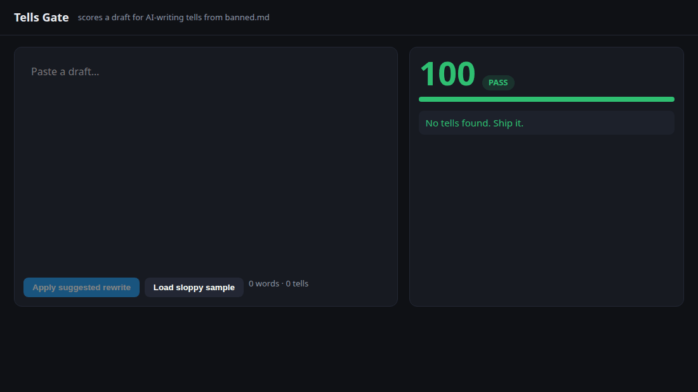

# Tells Gate

Scores a draft 0–100 for AI-writing tells, flags each one with its span, and suggests a rewrite.
The rules live in one file, [`banned.md`](banned.md): 17 rules, each with an id, why it reads as AI,
a fix, a rewriter, and a regex or a built-in detector. Edit the file to change the gate.



## Use it in 2 minutes

```bash
cd tells-gate                       # Python 3.10+, stdlib only
./tells-gate check tests/samples/bad/hype-thread.md          # human report, exit 1 on fail
./tells-gate check --diff tests/samples/bad/hype-thread.md   # the rewrite as a unified diff
./tells-gate check --json draft.md                            # machine report
echo "It quietly works." | ./tells-gate check --min-score 95 -
./tells-gate rules                                            # id, weight, cap, rewriter, fix
./tells-gate serve --port 4350      # live page at http://127.0.0.1:4350, rule pages at /rules/TG001, POST /check
make check                          # runs the unittest suite
```

Each hit's suggestion says what the rewrite did to it: the replacement text, `(delete)`,
`(removes the sentence)`, `(handled by TG009)`, or `(no automatic edit)`. The rewrite repairs only
the sentences it edited and copies every other byte, so clean text comes back unchanged.
`--diff` prints the score line on stderr and the diff on stdout. Stdout is empty when the rewrite
changes nothing. The exit code always comes from the draft's score, not the rewrite's.

Score: each rule costs `weight` per hit, capped at `cap`; long docs are judged by density
(hits per 200 words). `pass` ≥ 80, `warn` 60–79, `fail` < 60. Code blocks, inline code, HTML and
URLs are ignored. `--llm` runs an optional second pass that is a stub unless `TELLS_GATE_LLM_URL` is set.

Gate for X Post Queue: see [INTEGRATION.md](INTEGRATION.md). Build plan: [SPEC.md](SPEC.md), [seats/](seats/).

Inspired by @AISystems_hq and @Zephyr_hg's banned.md posts and @heydamir's unslopping pass.
Sample text in tests and the demo is synthetic.
